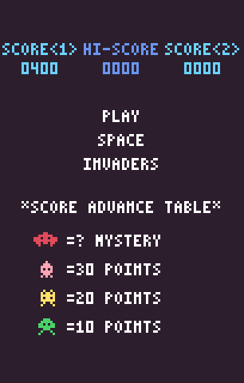
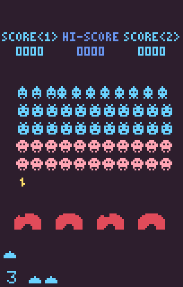

# スペースインベーダー Atari Lynx 移植（ファンメイド）

[English version](README.md)

1978年のアーケードの名作を Atari Lynx へ移植した、
非公式のファンメイド作品です（C言語、cc65）。TAITO 公式
とは関係ありません。

このプロジェクトで一番大事にしてきたのは、
「アーケードの雰囲気をそのままに」という点です。
それを表現が乏しいと思われる ATARI LYNX で実現し、今までに無いものを
作りたいと思い作成しました。この方針で全ての設計を進めました。

## 画面例

タイトル画面（アトラクトモード）です。



プレイ画面です。



## ビルドに必要なもの

- アーケード版基板のROMセット（TAITO/Midway、1978年、
  2 KiB × 4本。どのファイルかは下記「ビルド方法」参照）を、
  ご自身で用意してください。**このリポジトリにはアーケードの
  データは1バイトも含まれていません。** ROM はビルド時に
  SHA-256 で照合され、ゲームに必要なデータはあなたの
  環境でROMから生成されます。正しいROMが無ければ
  ビルドは止まります。
- Linux環境（cc65 2.19、Python 3、GNU make）。
  開発・検証は Ubuntu 24.04 で行い、作者は Windows 11 の
  WSL2（Ubuntu）でビルドしています。Ubuntu（WSL含む）
  では、コンパイラとサウンド変換ツールは
  `sudo apt install cc65 ffmpeg` で入ります。
- サウンドを付ける場合：`sounds/` への WAV 10本（下記「サウンド」に
  ついて）と ffmpeg。無ければ無音でビルドされ、そのまま
  遊べます。

ビルド済み `.lnx` は配布しません。ビルド結果にはROMから
生成したデータが含まれるためです。

## ビルド方法

ソースをZIPで入手した場合は、展開すると
`lynx-space-invaders-authentic/` フォルダができます。
以降の作業はそのフォルダの中で行います。

1. アーケード版基板のROMファイル4本を `rom/` に置きます。
   ゲームのプログラムROMで、2 KiB のバンクが1ファイルに
   なっています。

   | ファイル | アドレス範囲 | SHA-256（先頭16桁） |
   |---|---|---|
   | `invaders.h` | $0000 – $07FF | `1dfb19b1eeeac5b9` |
   | `invaders.g` | $0800 – $0FFF | `ac7031b046274d4c` |
   | `invaders.f` | $1000 – $17FF | `5c8e573ebde9a673` |
   | `invaders.e` | $1800 – $1FFF | `0a97ed62e2063c13` |

   手元のファイルが正しいものか分からないときは、そのまま
   ビルドを実行してみてください。最初のステップで各ファイル
   のSHA-256（完全な値は `tools/verify_rom.py` にあります）
   を照合し、合わないファイルがあれば名前を挙げて止まります。

2. 任意（サウンド用）：`rom/` と同じ場所に `sounds/`
   フォルダを作り、下記「サウンドについて」に挙げた
   WAV 10本を入れます。無ければ無音版になります。

3. ビルドします。

   ```sh
   make            # -> out/space-invaders-authentic.lnx
   ```

`make` は順に、ROM照合（`tools/verify_rom.py`）、素材の
生成（`tools/extract_assets.py`、`tools/extract_sprites.py`）、
サウンドの生成（`tools/gen_sound_data.py`）、`src/` の cc65
コンパイルを実行します。

## 原作に合わせた点、Lynx向けに変えた点

原作を厳密に真似をした点：

- 編隊は1体ずつ歩き、動きがWAVEのように伝わる（全員一斉の
  ブロック移動にはしていません）
- アトラクト：タイトル、スコア表、デモプレイ、クレジット
  画面。原作のギャグ2種も含みます
- 「PLAY PLAYER<1>」プロンプトと約3秒のウェイト、開始時と
  面ごとの編隊の配り表示
- 敵弾3種と原作の発射ルール（rolling は自機狙い、plunger は
  ROMの発射列テーブル、squiggly は円盤とスロット共用。
  再装填レートはスコア連動）
- ミステリースコア表、残り敵数で速くなる行進テンポ、
  壊れる防護壁、1500点の EXTEND

Lynx向けに変えた点（意図的な変更で、ソースに明記）：

- 画面の絵は全て Lynx の解像度に合わせて描き直し。敵と
  砲台のスプライトと小型フォントは手作業の模倣で、一部の
  パターン（フォント・表・squiggly弾・円盤の爆発）は
  ビルド時にあなたのROMから変換されます
- デモは上限1200更新でアトラクト周回を維持。円盤の進行
  方向はROMのバイト抽選の代わりに左右交互
- 編隊が着地しそうな局面では発射の先行入力を受け付けます

## 操作

- 左右：砲台の移動
- Aボタン：発射
- タイトル画面でいずれかのボタン：開始

## 動作確認環境

最終版について、以下で動作（画面とサウンド）を
確認しています。

- 実機（Atari Lynx I）
- Handy 0.95（Windows）
- Handy コア（libretro／RetroArch）
- Mednafen
- MAME（Lynxドライバ）

## サウンドについて

再生エンジン（Timer-7 割り込み DAC、IMA-ADPCM とRAW再生）
はこのリポジトリに含まれますが、サンプルそのものは
含まれません（アーケード版からのサンプリングのため）。
`sounds/` に次の名前で置けば、サウンド付きでビルドされます
（レートは不問、ビルド時に変換されます）。

- `shoot.wav` — 自機の発射サウンド（レーザーを撃ったときのサウンド）
- `killed.wav` — 敵を撃破したときのサウンド（短い爆発サウンド）
- `explosion.wav` — 自機がやられたときの爆発サウンド
- `extend.wav` — 1500点で残機が増えるときのサウンド（約1秒の
  トーン）
- `march1.wav` 〜 `march4.wav` — 編隊の行進サウンド。
  歩くたびに 1→2→3→4 と順に鳴り、敵が減るほど速く
  なります
- `ufo.wav` — 円盤の飛行サウンド（うねるようなサウンド）。1周期分を
  用意すると、飛行中ループ再生されます
- `ufohit.wav` — 円盤を撃墜したときのサウンド（約2秒、長く
  響くサウンド）

10本全てが揃っていなくても構いません。用意できた分は
使われ、用意できなかったサウンドは無音になります。
`sounds/` 自体が無ければ全体が無音版になります。

## 今後の予定

- タコが最後の1体として残ったとき、アーケード版には
  一部が消し忘れられてオーロラのような跡が残るバグが
  あります。その再現
- カニが歩くときに隣のカニとくっついて見える現象に
  ついて、デザインを変えない解決策の検討
- Handy 0.95（Windows）でサウンドが途切れ気味になる
  問題の改善

## クレジットと権利

- 原作ゲーム：SPACE INVADERS © TAITO CORPORATION
- 本移植（コード、Lynx向けの設計、ビルドツール一式）：
  © 2026 Koji Morishita、MIT ライセンス（[LICENSE](LICENSE)）
  で公開します。このライセンスが及ぶのは本移植自身の
  仕事だけで、原作ゲームの権利は含みません。

## 免責

本作は学習と保存を目的とした非営利のファン作品です。
TAITO とは関係がなく、アーケードのデータはこの
リポジトリに含まれていません。
